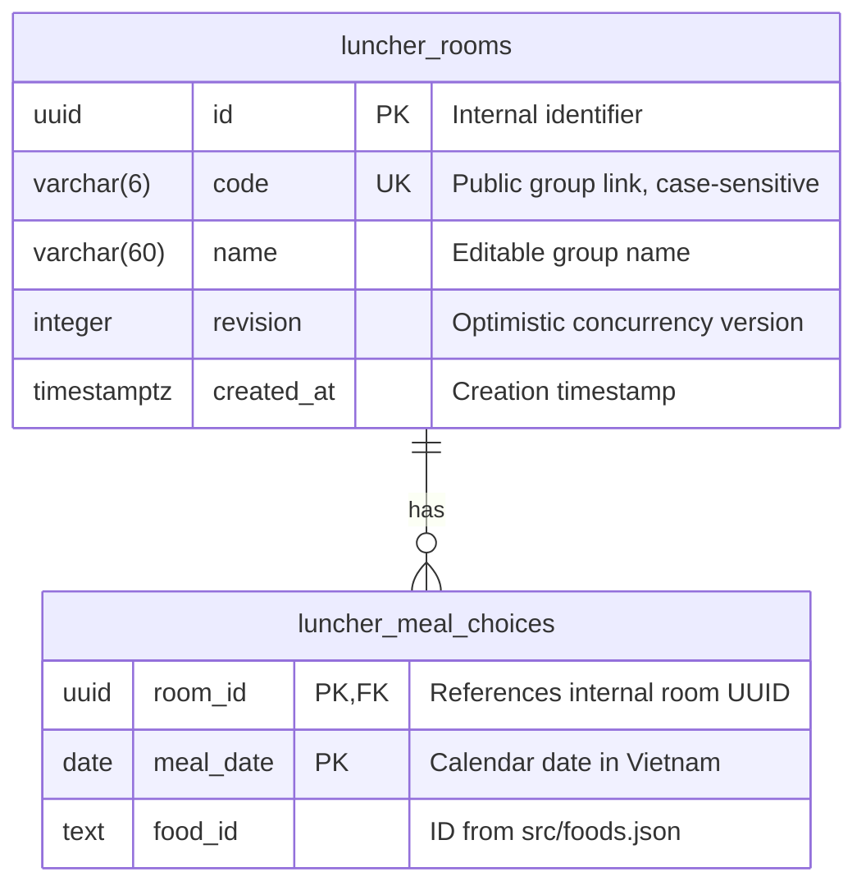

# Database design

Luncher uses Neon Postgres for shared groups. Personal history and theme preferences stay in browser storage and are not part of this schema.

## Entity relationships



There are no users, owners, memberships, or roles. Possession of the group link grants permission to read and change that group's data.

## Tables and constraints

### `luncher_rooms`

| Column | Type | Rules and purpose |
| --- | --- | --- |
| `id` | `uuid` | Primary key. Generated by the server with `randomUUID()`. Remains internal and is not exposed as a group link. |
| `code` | `varchar(6)` | Unique, case-sensitive public code. Exactly six ASCII letters or digits, enforced by `CHECK (code ~ '^[A-Za-z0-9]{6}$')`. `NOT NULL` after setup finishes. |
| `name` | `varchar(60)` | Required, nonblank after trimming. The API trims input and validates a maximum of 60 characters. Any group participant may rename it. |
| `revision` | `integer` | Required, defaults to `0`, cannot be negative. Increments with each accepted rename, confirmation, replacement, or undo. |
| `created_at` | `timestamptz` | Required, defaults to `now()`. |

The public URL is `/g/<code>`, such as `/g/Ab3xY9`. Uppercase and lowercase letters are distinct. Names can change; codes remain stable.

The internal UUID and public code are separate identifiers. Keeping the internal key avoids rewriting foreign keys or copying meal history when public links change. The API accepts only six-character codes; it does not resolve legacy UUID URLs.

### `luncher_meal_choices`

| Column | Type | Rules and purpose |
| --- | --- | --- |
| `room_id` | `uuid` | Required foreign key to `luncher_rooms.id`, with `ON DELETE CASCADE`. |
| `meal_date` | `date` | Required calendar date, not an instant in time. |
| `food_id` | `text` | Required stable food identifier from `src/foods.json`, such as `mi-quang`. |

The composite primary key `(room_id, meal_date)` permits **one confirmed dish per group per day**. Replacing a choice updates that row; undoing deletes it. Historical replacements and undo events are not retained as an audit log.

`food_id` is validated by the API against the JSON catalog; it has no database foreign key because there is no `foods` table. Keep existing food IDs stable when editing the catalog so saved history remains readable.

### Indexes

Postgres creates indexes for the room UUID primary key, unique public code, and composite meal primary key. The meal index also supports per-room history and date-range lookups through its leading `room_id` column. There are currently no additional indexes.

## Public code generation

New groups receive six characters selected using Node's cryptographic `randomInt()` from `A–Z`, `a–z`, and `0–9` (62 possible characters). This gives `62^6`, or 56,800,235,584, possible codes.

Creation attempts an insert with `ON CONFLICT (code) DO NOTHING`. If the code is already taken, the server generates another one, up to 20 attempts. Uniqueness is enforced by Postgres, not by a separate existence check.

These short links are a convenience for small groups, not an authentication system. Groups have no public directory, but anyone who obtains or guesses a valid link has edit access. Do not use group names for sensitive information.

## Calendar and history

- The server derives today's date using `Asia/Ho_Chi_Minh`.
- A week starts on Monday and ends on Sunday.
- By default, a dish confirmed earlier in the same week is ineligible for another day.
- The repeat override explicitly allows an already-used dish.
- A confirmation for today is excluded from the wheel until undone, replaced, or repeats are enabled.
- The server rejects meal writes from pages carrying an outdated date, such as a tab left open across midnight.
- Prior weeks' records remain stored. They stop affecting eligibility when the new week begins.

The database stores confirmed choices only. Wheel spins, category filters, theme choices, and unconfirmed suggestions are not stored in Neon.

## Read and write flows

### Read a group

`GET /api/rooms?id=<code>` returns:

```json
{
  "room": {
    "id": "Ab3xY9",
    "name": "Lunch crew",
    "revision": 3,
    "history": [
      { "foodId": "mi-quang", "date": "2026-10-27" }
    ]
  },
  "today": "2026-10-27"
}
```

The response field `room.id` is the **public code**, not the internal UUID. A single SQL statement reads the name, revision, and history together so they describe the same snapshot. Responses use `Cache-Control: private, no-store`.

### Create

`POST /api/rooms` with `{ "action": "create", "name": "Lunch crew" }` creates the room and returns its public code and empty history. Creation does not copy personal browser history into the group.

### Confirm or replace

The client submits `action`, public `id`, last-read `revision`, server-provided `today`, `foodId`, and a boolean `repeat`.

1. The API validates the request and checks the server's current day.
2. A SQL common table expression updates the room only if the revision still matches, today's existing-choice state matches the action, and weekly eligibility permits the dish.
3. That same statement inserts or replaces the day's meal using the claimed room UUID.
4. The API returns the updated room.

`confirm` requires no existing choice for today. `replace` requires an existing choice. A failed condition changes neither the choice nor the revision.

### Undo

The client submits `action: "undo"`, public `id`, `revision`, and `today`. A single statement checks the revision, increments it, and deletes today's choice. It cannot delete another day's history.

### Rename

The client submits `action: "rename"`, public `id`, `revision`, and `name`. The server trims and validates the name, then updates it only if the revision matches. A rename increments the revision but does not change the code, history, or creation time. It does not require a meal date.

### Conflicts and failures

All mutations use optimistic concurrency. If two clients submit the same revision, the room-row update allows only one to succeed. The other receives HTTP `409` with the current room, rather than overwriting the accepted change. Unavailable dishes and mismatched confirm/replace state also return `409`.

Group data is never written to `localStorage` as an offline substitute. A timed-out write may have committed, so the client does not automatically retry it. Refresh the group to retrieve the authoritative state.

## Schema setup and migration

Run:

```sh
npm run db:setup
```

Vercel runs the same setup through `npm run build:vercel`. The connection comes from server-only `DATABASE_URL`, falling back to `POSTGRES_URL`.

Setup consists of two resumable phases:

1. Apply the SQL statements in [`db/schema.sql`](../db/schema.sql) in a transaction. Create missing tables and add the nullable, unique `code` column if it is missing.
2. Backfill rooms without codes using [`server/room-codes.js`](../server/room-codes.js), then set `code` to `NOT NULL`.

For an existing room, the first code candidate is derived from SHA-256 of its internal UUID and an attempt number, mapped to six base-62 characters. This makes the initial candidate reproducible across migration retries. If a unique constraint collision occurs, the attempt number changes. Existing non-null codes are never reassigned.

Backfill updates each room independently. If setup is interrupted, rerunning it resumes remaining rooms. The final non-null constraint is applied only after all rooms have codes. Running the SQL file alone does **not** complete this data migration.

UUID primary keys, meal foreign keys, names, creation times, revisions, and history remain unchanged. Only the public link changes. Once the updated API is deployed, legacy UUID links are rejected.

## Source map

| File | Responsibility |
| --- | --- |
| [`db/schema.sql`](../db/schema.sql) | Table definitions and additive SQL migration |
| [`scripts/setup-db.js`](../scripts/setup-db.js) | Neon schema setup and code backfill |
| [`server/room-codes.js`](../server/room-codes.js) | Code generation, collision retries, existing-room migration |
| [`server/rooms.js`](../server/rooms.js) | Parameterized SQL reads and atomic writes |
| [`server/handler.js`](../server/handler.js) | Request validation, action dispatch, conflict responses |
| [`server/calendar.js`](../server/calendar.js) | Shared Vietnam calendar and week boundaries |
| [`api/rooms.js`](../api/rooms.js) | Neon connection and Vercel handler |
| [`tests/rooms.test.js`](../tests/rooms.test.js) | Schema, migration, API, concurrency, and history tests |

The schema currently has no automatic retention policy, deletion endpoint, or audit-event table. Any future food catalog or membership feature should introduce an explicit migration and update this document.
