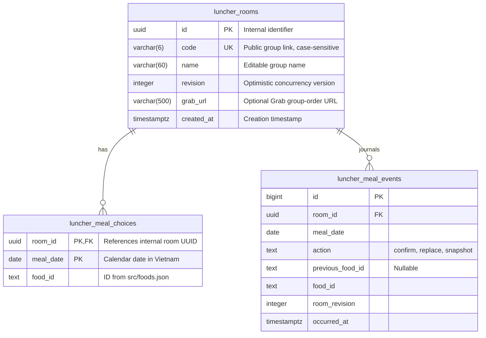

# Database design

Luncher uses Neon Postgres for shared groups. Personal history and theme preferences stay in browser storage and are not part of this schema.

## Analytics boundary

[Vercel Web Analytics](vercel-analytics.md) covers only eligible clean public-homepage pageviews. Group URLs, group identifiers/names, Grab order links, meal data, management links, and browser storage are excluded. The integration adds no database tables, columns, events, or server credentials; it does not turn recent-group shortcuts into a public directory.

## Entity relationships



There are no users, owners, memberships, or roles. Possession of the group link grants permission to read and change that group's data.

## Tables and constraints

### `luncher_rooms`

| Column | Type | Rules and purpose |
| --- | --- | --- |
| `id` | `uuid` | Primary key. Generated by the server with `randomUUID()`. Remains internal and is not exposed as a group link. |
| `code` | `varchar(6)` | Unique, case-sensitive public code. Exactly six ASCII letters or digits, enforced by `CHECK (code ~ '^[A-Za-z0-9]{6}$')`. `NOT NULL` after setup finishes. |
| `name` | `varchar(60)` | Required, nonblank after trimming. The API trims input and validates a maximum of 60 characters. Any group participant may rename it. |
| `revision` | `integer` | Required, defaults to `0`, cannot be negative. Increments with each accepted rename, confirmation, replacement, or Grab-link update. |
| `grab_url` | `varchar(500)` | Nullable Grab group-order URL. SQL requires an `https://` prefix; the API additionally validates allowed hosts, absence of embedded credentials, and the 500-character limit. |
| `created_at` | `timestamptz` | Required, defaults to `now()`. |

The public URL is `/g/<code>`, such as `/g/Ab3xY9`. Uppercase and lowercase letters are distinct. Names can change; codes remain stable.

The internal UUID and public code are separate identifiers. Keeping the internal key avoids rewriting foreign keys or copying meal history when public links change. The API accepts only six-character codes; it does not resolve legacy UUID URLs.

### `luncher_meal_choices`

| Column | Type | Rules and purpose |
| --- | --- | --- |
| `room_id` | `uuid` | Required foreign key to `luncher_rooms.id`, with `ON DELETE CASCADE`. |
| `meal_date` | `date` | Required calendar date, not an instant in time. |
| `food_id` | `text` | Required stable food identifier from `src/foods.json`, such as `mi-quang`. |

The composite primary key `(room_id, meal_date)` permits **one confirmed dish per group per day**. Replacing a choice updates that row and appends an event to the separate journal. There is no public undo/delete action. Cancelling an unconfirmed replacement does not write to the database.

`food_id` is validated by the API against the JSON catalog; it has no database foreign key because there is no `foods` table. Keep existing food IDs stable when editing the catalog so saved history remains readable.

Catalog entries with `active: false` remain in `src/foods.json` for historical lookup and backwards-compatible API ID validation, but are excluded from the current frontend menu and eligibility pool. The eight active choices reuse stable existing IDs where applicable; new IDs are `banh-canh-cua`, `mi-hoanh-thanh`, and `bun-moc`. Illustration indices are presentation metadata only. No stored choices, events, schema, or browser keys are rewritten.

### `luncher_meal_events`

| Column | Type | Rules and purpose |
| --- | --- | --- |
| `id` | `bigint` | Identity primary key. |
| `room_id` | `uuid` | Required FK to the internal room ID, with `ON DELETE CASCADE`. |
| `meal_date` | `date` | Required Vietnam calendar date of the meal. |
| `action` | `text` | Required; `confirm`, `replace`, or `snapshot`. |
| `previous_food_id` | `text` | Required for replacement; null for confirmation or baseline. A replacement must choose a different dish. |
| `food_id` | `text` | Required chosen food ID. |
| `room_revision` | `integer` | Required, nonnegative revision associated with the accepted change or migration baseline. |
| `occurred_at` | `timestamptz` | Required; defaults to the server's current time. Stored as an instant and displayed in Vietnam time. |

The unique key `(room_id, meal_date, room_revision)` prevents duplicate events for the same change. Application writes only append events; replacing a dish never edits or deletes earlier journal entries. This is an activity journal, not a tamper-proof ledger: a database administrator can change it, and deleting a room administratively cascades to its records.

No actor identity is stored. The journal shows **what changed and when**, not who performed it. Names, devices, or authentication have not been added.

### Indexes

Postgres creates indexes for the room UUID primary key, unique public code, and composite meal primary key. The meal index also supports per-room history and date-range lookups through its leading `room_id` column. The journal has its identity/unique indexes plus `(room_id, occurred_at, id)` for per-room chronological reads.

## Public code generation

New groups receive six characters selected using Node's cryptographic `randomInt()` from `A–Z`, `a–z`, and `0–9` (62 possible characters). This gives `62^6`, or 56,800,235,584, possible codes.

Creation attempts an insert with `ON CONFLICT (code) DO NOTHING`. If the code is already taken, the server generates another one, up to 20 attempts. Uniqueness is enforced by Postgres, not by a separate existence check.

These short links are a convenience for small groups, not an authentication system. Groups have no public directory, but anyone who obtains or guesses a valid link has edit access. Do not use group names for sensitive information.

## Calendar and history

- The server derives today's date using `Asia/Ho_Chi_Minh`.
- A week starts on Monday and ends on Sunday.
- By default, a dish confirmed earlier in the same week is ineligible for another day.
- The repeat override explicitly allows an already-used dish.
- After confirmation, the wheel and food filters are locked. Enter replacement mode explicitly to unlock them; the existing dish stays confirmed until the new selection is saved. Same-dish replacements are rejected.
- Only final daily choices affect weekly eligibility. An earlier suggestion that was replaced remains in the journal but does not count as another meal eaten.
- The server rejects meal writes from pages carrying an outdated date, such as a tab left open across midnight.
- Prior weeks' records remain stored. They stop affecting eligibility when the new week begins.

The database stores current daily choices and their confirmation/replacement journal. Wheel spins, category filters, theme choices, and unconfirmed suggestions are not stored in Neon.

## Read and write flows

### Read a group

`GET /api/rooms?id=<code>` returns:

```json
{
  "room": {
    "id": "Ab3xY9",
    "name": "Lunch crew",
    "revision": 3,
    "grabUrl": null,
    "history": [
      { "foodId": "mi-quang", "date": "2026-10-27" }
    ],
    "events": [
      {
        "id": 1,
        "action": "confirm",
        "date": "2026-10-27",
        "foodId": "mi-quang",
        "previousFoodId": null,
        "occurredAt": "2026-10-27T02:37:00.000Z"
      }
    ]
  },
  "today": "2026-10-27"
}
```

The response field `room.id` is the **public code**, not the internal UUID. A single SQL statement reads the name, revision, current choices, and journal together so they describe the same snapshot. Responses use `Cache-Control: private, no-store`.

### Create

`POST /api/rooms` with `{ "action": "create", "name": "Lunch crew" }` creates the room and returns its public code and empty history. Creation does not copy personal browser history into the group.

### Confirm or replace

The client submits `action`, public `id`, last-read `revision`, server-provided `today`, `foodId`, and a boolean `repeat`.

1. The API validates the request and checks the server's current day.
2. A SQL common table expression updates the room only if the revision still matches, today's existing-choice state matches the action, and weekly eligibility permits the dish.
3. That same statement inserts or replaces the day's meal using the claimed room UUID.
4. The statement appends a journal event containing the previous dish, new dish, date, time, and claimed revision. If event insertion fails, the entire statement rolls back, including the meal and revision.
5. The API returns the updated room and journal.

`confirm` requires no existing choice for today. `replace` requires an existing choice. A failed condition changes neither the choice nor the revision.

### Cancelling a replacement

Cancellation is a client-only operation: discard the pending suggestion and relock the wheel. The saved choice and journal remain unchanged. The former `undo` API action is rejected, including calls from older browser tabs.

### Rename

The client submits `action: "rename"`, public `id`, `revision`, and `name`. The server trims and validates the name, then updates it only if the revision matches. A rename increments the revision but does not change the code, history, or creation time. It does not require a meal date.

### Save or clear a Grab group-order link

`POST /api/rooms` accepts `{ "action": "grab", "id": "Ab3xY9", "revision": 3, "grabUrl": "https://r.grab.com/g/example" }`. `today` is not required. The API trims and normalizes the URL, permitting only HTTPS URLs on `grab.com`, its subdomains, or exactly `grab.onelink.me`, with no embedded username/password and at most 500 characters before and after normalization. An empty or whitespace-only string clears the field to SQL `NULL`; invalid input returns `400`.

The parameterized update checks the room revision and increments it on acceptance. A stale revision returns `409` with the current room. This operation changes neither daily choices nor meal events. The link persists until explicitly changed or cleared; there is no daily reset, expiry check, or Grab order creation.

### Group page and QR preview

Vercel rewrites `/g/:id` to `/api/group-page?id=:id`. The handler reads the shared store and injects escaped group metadata into the built SPA shell. A saved Grab link adds an Open Graph image URL at `/api/qr?id=<code>&v=<hash>`. Missing groups or database lookup failures fall back to the unmodified app shell; the client still loads group data through `/api/rooms`. HTML responses are private and not cached.

The QR endpoint accepts `GET` and `HEAD`, returning a 1200×630 PNG encoding the saved Grab URL. It returns `400` for invalid codes, `404` for absent groups/links, `405` for unsupported methods, and `503` for lookup/render failures. Successful images use `Cache-Control: public, max-age=300`; failures use `no-store`. The version is the first ten SHA-256 hex characters of the Grab URL. It changes the image URL when the link changes, but is not an immutable historical image or access token: the endpoint always renders the current saved link. Chat services may retain their own cached previews.

Anyone with the group code, including preview crawlers, can retrieve its saved Grab URL or QR. No additional authentication or new table is introduced.

### Conflicts and failures

All mutations use optimistic concurrency. If two clients submit the same revision, the room-row update allows only one to succeed. The other receives HTTP `409` with the current room, rather than overwriting the accepted change. Unavailable dishes and mismatched confirm/replace state also return `409`.

Group data is never written to `localStorage` as an offline substitute. A timed-out write may have committed, so the client does not automatically retry it. Refresh the group to retrieve the authoritative state.

## Schema setup and migration

Run:

```sh
npm run db:setup
```

Vercel runs the same setup through `npm run build:vercel`. The connection comes from server-only `DATABASE_URL`, falling back to `POSTGRES_URL`.

Setup consists of two resumable phases:

1. Apply the SQL statements in [`db/schema.sql`](../db/schema.sql) in a transaction, followed by sorted, idempotent SQL files in `db/migrations/`. Create missing tables, add public-code and nullable `grab_url` columns if needed, and populate journal baselines for existing daily choices that have no events.
2. Backfill rooms without codes using [`server/room-codes.js`](../server/room-codes.js), then set `code` to `NOT NULL`.

For an existing room, the first code candidate is derived from SHA-256 of its internal UUID and an attempt number, mapped to six base-62 characters. This makes the initial candidate reproducible across migration retries. If a unique constraint collision occurs, the attempt number changes. Existing non-null codes are never reassigned.

Backfill updates each room independently. If setup is interrupted, rerunning it resumes remaining rooms. The final non-null constraint is applied only after all rooms have codes. Running the SQL file alone does **not** complete this data migration.

UUID primary keys, meal foreign keys, names, creation times, revisions, and history remain unchanged. Only the public link changes. Once the updated API is deployed, legacy UUID links are rejected.

### Existing choices and known historical times

Existing choices without a journal receive one `snapshot` entry. Its timestamp is when the migration records the baseline, **not** the original selection time. The UI labels this distinction, and rerunning setup does not duplicate entries.

When the user supplies the original time, an explicit scoped data migration can correct that baseline. [`db/migrations/20261027-access-group-confirmation.sql`](../db/migrations/20261027-access-group-confirmation.sql) records the user's Mì Quảng confirmation at **09:37 on 27 October 2026, Asia/Ho_Chi_Minh** (`02:37 UTC`) for The Access Group. It only upgrades that group's matching snapshot, preserves the current daily meal, and is safe to rerun.

### Personal mode

Personal choices and journal entries are saved together as `{ history, events }` under `luncher-personal-v2` in `localStorage`. Existing `luncher-history-v1` entries are imported as labeled baselines. A single storage write saves each confirmation/replacement, while cancellation makes no change. These records do not enter Neon or acquire a member identity.

### Recent group shortcuts

`luncher-recent-groups-v1` stores up to 10 `{ id, name, lastVisited }` entries in browser `localStorage`. The `id` is a validated six-character public code; `lastVisited` is an epoch timestamp in milliseconds. This is a local shortcut list, not room membership or a public directory. The server has no endpoint for listing every group.

Only successful visits create entries. Revisiting deduplicates and moves the group to the front; reads/renames can update an existing label without recreating a forgotten entry. Removing a shortcut never deletes a database room, choice, or journal event. Invalid/offline room loads are not added. Names are escaped when rendered.

## Source map

| File | Responsibility |
| --- | --- |
| [`db/schema.sql`](../db/schema.sql) | Table definitions and additive SQL migration |
| [`scripts/setup-db.js`](../scripts/setup-db.js) | Neon schema setup, scoped data migrations, and code backfill |
| [`db/migrations/`](../db/migrations/20261027-access-group-confirmation.sql) | Idempotent data patches applied in filename order |
| [`src/activity.js`](../src/activity.js) | Personal journal persistence and legacy import |
| [`src/recent-groups.js`](../src/recent-groups.js) | Browser-private recent group shortcuts, validation, and 10-item limit |
| [`server/room-codes.js`](../server/room-codes.js) | Code generation, collision retries, existing-room migration |
| [`server/rooms.js`](../server/rooms.js) | Parameterized SQL reads and atomic writes |
| [`server/handler.js`](../server/handler.js) | Request validation, action dispatch, conflict responses |
| [`server/calendar.js`](../server/calendar.js) | Shared Vietnam calendar and week boundaries |
| [`api/rooms.js`](../api/rooms.js) | Vercel group-data handler |
| [`server/neon.js`](../server/neon.js) | Shared server-only Neon store |
| [`server/grab.js`](../server/grab.js) | Grab URL normalization and validation |
| [`server/preview.js`](../server/preview.js) | Escaped preview metadata, QR PNG rendering, and response caching |
| [`api/group-page.js`](../api/group-page.js) | Built app-shell loading and group preview handler |
| [`api/qr.js`](../api/qr.js) | Group QR image handler |
| [`tests/grab.test.js`](../tests/grab.test.js) | Grab validation, revision checks, preview fallback, and QR endpoint tests |
| [`tests/rooms.test.js`](../tests/rooms.test.js) | Schema, migration, API, concurrency, and history tests |

The schema currently has no automatic retention policy or public deletion endpoint. Any future food catalog or membership feature should introduce an explicit migration and update this document.
